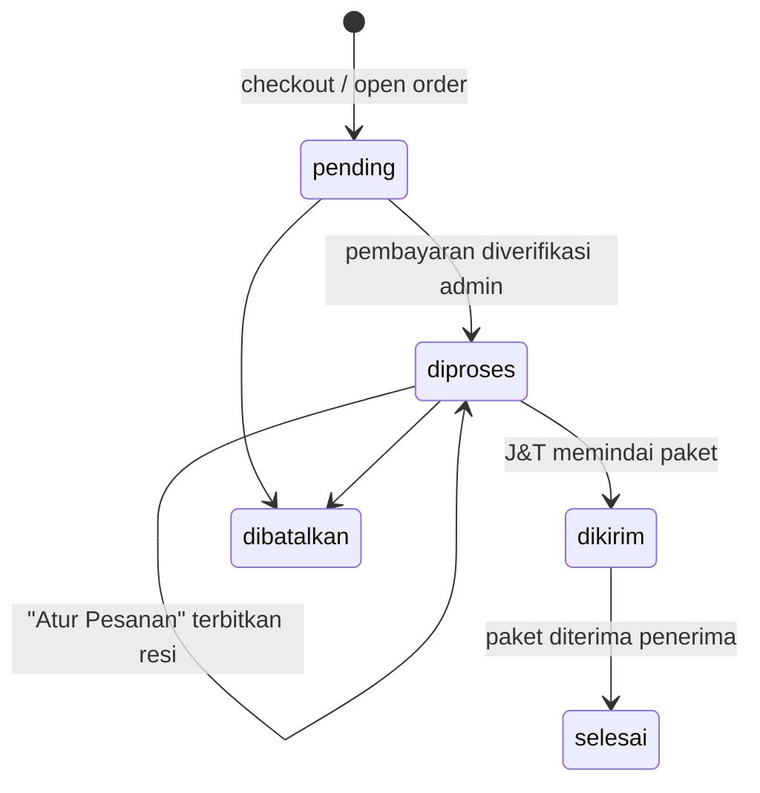
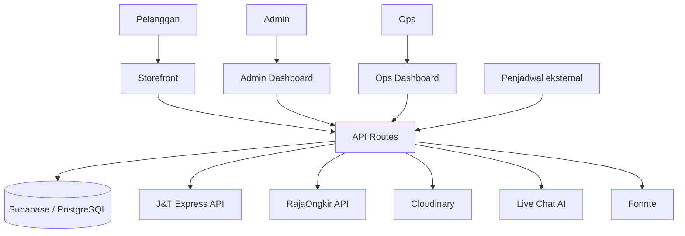

# SAMAQU

**E-Commerce & Business System** — platform produksi untuk SAMAQU, brand pakaian muslim pria
(Thobe · Kandora · Koko · Vest · Kabak · Cover & Hanger).


> **Live:** <https://www.samaqu.id/>

---

## Ringkasan

SAMAQU adalah satu sistem yang melayani **tiga sisi** sekaligus: **storefront** untuk pelanggan,
**dashboard admin** untuk operasional penjualan, dan **dashboard ops** untuk CRM, stok, dan
follow-up. Semuanya berbagi satu sumber data di **Supabase (PostgreSQL)** — tidak ada duplikasi
aturan bisnis antar sisi.

| Sisi | Untuk | Isi utama |
|------|-------|-----------|
| 🛍️ **Storefront** | Pelanggan | Katalog, Create Your Price, Open Order, keranjang, checkout, akun & lacak pesanan, halaman konten, live chat AI |
| 🧑💼 **Admin** | Pemilik / admin | Pesanan (termasuk resi J&T & label), produk, Open Order, pelanggan, live chat, voucher, seluruh konten website, pengaturan |
| 📊 **Ops** | Tim operasional | Leads & follow-up (CRM), pelanggan, produk & stok, pembelian, laporan |

---

## ✨ Fitur Unggulan

| Fitur | Kenapa Istimewa |
|-------|-----------------|
| **Hierarchical catalog** | Taksonomi `Kategori → Jenis Kain → Series → Produk/Varian` (warna × ukuran), lengkap dengan media per varian |
| **Create Your Price (CYP)** | Pelanggan menentukan harganya sendiri; **divalidasi ulang di server** terhadap harga minimum di database — harga dari klien tidak pernah dipercaya |
| **Open Order wizard** | Alur 6 langkah terpisah dengan harga minimum per series, memotong **stok yang sama** dengan katalog, dan wajib punya akun |
| **Atomic stock** | `samaqu_decrement_stock` dengan row-lock; kalau ada satu item gagal, semua decrement di-rollback |
| **Status pesanan ≠ status pengiriman** | `orders.status` dan `orders.shipping_status` dipisah; resi terbit ≠ paket berangkat |
| **J&T lifecycle penuh** | Tariff, Order (AWB), Cancel (void), Track — dengan **pemetaan 7.128 baris** area |
| **RajaOngkir V2** | Ongkir + pencarian tujuan dengan caching bertingkat |
| **Live Chat AI** | Asisten AI (Xiaomi MiMo) di storefront, dengan log & pengaturan dari admin |
| **CRM internal** | Leads, Follow-up Center, dan sinkronisasi otomatis order → lead |
| **Shared admin & ops** | Pusat data pelanggan, aturan urutan, dan filter — **satu modul**, dua dashboard |

---

## 🛍️ Fitur Storefront

| Halaman / Fitur | Rute | Keterangan |
|-----------------|------|------------|
| Home | `/` | Hero, koleksi, jaminan, testimoni, Instagram |
| Katalog | `/katalog` | Daftar produk lintas kategori + filter jenis kain |
| Detail produk | `/katalog/[id]` | Galeri per varian, pemilih warna/series/ukuran, harga minimum (CYP) |
| Create Your Price | `/create-your-price` | Halaman promo + alur CYP |
| Open Order | `/open-order` | Wizard 6 langkah: produk → detail → keranjang → data pemesan → review → sukses |
| Keranjang | `/cart` | State keranjang + add-on Cover & Hanger |
| Checkout | `/checkout` | Multi-langkah: alamat tersimpan/manual, ongkir otomatis, voucher, metode pembayaran |
| Sukses | `/checkout/success` | Nomor pesanan + status "Menunggu Konfirmasi Admin" |
| Akun & pesanan | `/akun`, `/akun/pesanan`, `/akun/pesanan/[no]`, `.../lacak` | Dashboard, daftar pesanan (tab Semua/Belum Bayar/Diproses/Dikirim/Selesai), detail bergaya marketplace, lacak paket |
| Alamat & profil | `/akun/alamat`, `/akun/profil` | Alamat tersimpan (kota/kecamatan RajaOngkir), profil read-only + Edit |
| Wishlist | `/akun/wishlist` | Produk favorit |
| Konten | `/tentang-kami`, `/faq`, `/panduan-ukuran`, `/testimoni`, `/cara-pesan`, `/garansi-retur`, `/sama-quran`, `/bio` | Halaman konten yang diatur dari admin |
| Live Chat AI | widget | Asisten AI + eskalasi ke WhatsApp toko |

- **Dwibahasa** (ID / EN) lewat `next-intl`.
- **Meta Pixel + CAPI** — ViewContent, AddToCart, InitiateCheckout, Purchase.
- **Nav bawah ala aplikasi** di mobile (Beranda · Kategori · Open Order · Pesanan · Akun).

---

## 🧑💼 Dashboard Admin

Tiga grup menu di sidebar:

**Menu Utama** — Dashboard · Order Management · Open Order · Produk · Pelanggan · Live Chat
**Konten** — Konten Website · Biolink · Foto Carousel · Testimoni · Panduan Ukuran · Halaman Garansi & Retur
**Lainnya** — Voucher · Pengaturan

### Order Management

- Daftar pesanan ala Shopee Seller Centre: sub-tab **Pesanan Website / Open Order**, kotak cari, dan tahap **Semua · Belum Bayar · Perlu Dikirim · Dikirim · Selesai · Dibatalkan**.
- **Drawer detail pesanan** berisi banner status → Info Pengiriman (kurir + nomor resi + status pengiriman) → Metode Pembayaran → Alamat → produk → Total → linimasa status → aksi.
- **Atur Pesanan** menerbitkan resi J&T (khusus status `diproses`), **Lacak Paket** menyinkronkan tracking dari J&T, **Batalkan J&T** mem-void resi, **Cetak Label** membuka `/admin/label/[orderNumber]`.
- Aksi hanya ada di drawer detail (tabel daftar tetap bersih).

### Produk & konten

- Form produk bersama (tambah/edit) dengan grid ukuran, SKU per ukuran, berat per size, dan toggle **Tampilkan di Open Order**.
- Drawer detail produk: stok & SKU per varian, harga, riwayat penjualan.
- CMS konten: hero, koleksi, testimoni, panduan ukuran, biolink, foto carousel, halaman garansi & retur.
- **Voucher**: diskon persen/nominal, minimal belanja, batas pemakaian, dan batas per nomor WhatsApp.

---

## 📊 Dashboard Ops

Dashboard terpisah (`/ops`) untuk tim operasional:

| Menu | Isi |
|------|-----|
| **Dashboard** | Ringkasan penjualan, tren harian, stok menipis |
| **Leads** / **Laporan Leads** | Daftar lead + statistik konversi, closing, nominal |
| **Follow-up** | Follow-up Center: Perlu Dijadwalkan · Hari Ini · Terlambat · Riwayat |
| **Pelanggan** | Pusat data pelanggan (modul yang sama dengan admin) |
| **Produk** | Master produk & stok, barang masuk/keluar, rekap pembelian |

> Order baru **tidak** membuat lead baru. Kalau nomor order cocok dengan lead aktif, lead itu
> otomatis ditandai `closing` + `outcome: buy` (`src/lib/ops-lead-sync.ts`) — idempoten.

---

## 🔌 Integrasi

| Layanan | Fungsi | Auth |
|---------|--------|------|
| **Supabase (PostgreSQL)** | Seluruh data + Auth | anon key (publik) & service role (server-only) |
| **J&T Express** | Tariff, Order/AWB, Cancel, Track | Signature `base64(md5(data + key))` (order/tariff/cancel) & Basic Auth (track) |
| **RajaOngkir V2** | Ongkir + pencarian tujuan (cached) | API key (DB, env sebagai fallback) |
| **Cloudinary** | Media produk & konten (+ akun terpisah untuk gambar live chat) | signed upload |
| **Fonnte** | Notifikasi WhatsApp ke admin saat ada pesanan baru | token (DB/env) |
| **Xiaomi MiMo** | Asisten Live Chat AI (OpenAI-compatible) | API key (DB/env) |
| **Meta Pixel + CAPI** | Tracking event e-commerce | Pixel ID + access token |

### J&T — pemetaan area

Nama wilayah RajaOngkir diterjemahkan ke kode internal J&T lewat dataset **7.128 baris**
(`src/lib/jnt/area-data.json`), dengan fallback bertingkat: kecamatan+kota → kecamatan → kota.

---

## 🤖 Otomasi (Cron)

Tanpa webhook dari J&T — sinkronisasi memakai **polling** dari penjadwal eksternal
(cron-job.org), diakses dengan header `Authorization: Bearer $CRON_SECRET`:

| Endpoint | Fungsi | Jadwal saran |
|----------|--------|--------------|
| `GET /api/cron/sync-tracking` | Tarik tracking J&T → naikkan status (`dikirim`) & tandai `selesai` saat paket diterima | tiap jam |
| `GET /api/cron/auto-cancel` | Batalkan pesanan yang melewati batas waktu pembayaran | tiap jam |

---

## 🚚 Alur Pesanan



**Dua status yang dipisah** (`orders.status` vs `orders.shipping_status`):

| | Nilai |
|---|---|
| `orders.status` | `pending` → `diproses` → `dikirim` → `selesai` (+ `dibatalkan`) |
| `orders.shipping_status` | `NULL` (belum ada resi) → `menunggu_pickup` → `dikirim` → `selesai` |

- **Resi diterbitkan admin** lewat **Atur Pesanan**, bukan saat checkout (`awb_no` awalnya `null`).
- **Nomor pesanan**: `SMQ-` (checkout website) dan `CYO-` (Open Order).
- **Stok**: dipotong atomik sebelum pesanan ditulis, dengan rollback bila ada yang gagal;
  dikembalikan saat pembatalan **hanya jika** `orders.stock_reserved` bernilai true.
- **Satu jalur pembatalan** — `cancelOrderCompletely()`: void resi J&T → kembalikan stok → status `dibatalkan`.

---

## 🧱 Arsitektur



| Layer | Isi |
|-------|-----|
| **Presentation** | Next.js App Router, React 19, Tailwind 4, Framer Motion |
| **Application** | API Routes (validasi bisnis & integrasi) |
| **Data** | Supabase / PostgreSQL (+ RLS) |
| **External** | J&T, RajaOngkir, Cloudinary, Fonnte, MiMo, Meta |
| **Auth** | Supabase Auth — sesi admin & pelanggan dipisah |

---

## 📦 Tech Stack

| Kategori | Teknologi |
|----------|-----------|
| Framework | Next.js 16 (App Router, Turbopack) |
| UI | React 19, Tailwind CSS 4, Framer Motion, Radix/Ark/Base UI, Lucide + Phosphor |
| Data | Supabase (PostgreSQL), `@supabase/supabase-js` |
| Data fetching | TanStack Query |
| Chart | Recharts |
| PDF / Barcode | `pdf-lib`, `pdfjs-dist`, `jsbarcode` |
| i18n | next-intl (ID/EN) |
| Deploy | Vercel |

---

## 🔐 Keamanan

- **Harga CYP divalidasi di server** — harga minimum selalu dibaca dari database.
- **Ongkir tidak dipercaya dari klien** — dihitung/diverifikasi lewat API.
- **Stok atomik** dengan row-lock + rollback.
- **Kredensial sensitif hanya di server** — service role key, kredensial J&T, token Fonnte, dan API key live chat tidak pernah dikirim ke browser (tabel pengaturan bersifat service-role-only).
- **Admin & ops diverifikasi** lewat tabel `admins` + sesi Supabase.
- **Rahasia tidak ada di repo** — `.env*` di-`.gitignore`, tidak ada token di kode maupun riwayat commit.

---

## 🗂️ Struktur Proyek

```
src/
├── app/
│   ├── (customer)/         # Storefront (root, redirect ke /<locale>)
│   ├── [locale]/           # Storefront + akun pelanggan (ID/EN)
│   │   ├── (customer)/     # katalog, cart, checkout, open-order, konten…
│   │   ├── akun/           # dashboard pelanggan, pesanan, lacak, alamat, profil
│   │   └── admin/          # salinan subhalaman admin (route /admin juga ada)
│   ├── admin/              # Dashboard admin (+ label, produk, konten, voucher…)
│   ├── ops/                # Dashboard ops (leads, follow-up, pelanggan, stok)
│   └── api/                # API routes
│       ├── admin/          # orders, customers, chat/fonnte/jnt settings
│       ├── ops/            # leads, followups, customers, products, stock-in
│       ├── jnt/            # track, mapping, test
│       ├── shipping/       # cost, jnt-cost, provinces, districts, search
│       ├── cron/           # sync-tracking, auto-cancel
│       └── orders/, open-order/, chat/, cloudinary/, meta-events/
├── components/             # UI (admin/, ops/, akun/, open-order/…)
├── lib/                    # Logika bisnis & integrasi (jnt/, cancel-order, order-flow…)
├── i18n/                   # Pesan ID/EN
└── middleware.ts           # Routing locale
supabase/                   # SQL migrasi (dijalankan manual) + RPC stok
public/                     # Aset statis
```

---

## ⚙️ Environment Variables

```env
# ── Supabase (wajib) ──
NEXT_PUBLIC_SUPABASE_URL=
NEXT_PUBLIC_SUPABASE_ANON_KEY=
SUPABASE_SERVICE_ROLE_KEY=        # atau SUPABASE_SECRET_KEY

# ── J&T Express ──
JNT_ENV=production
JNT_ORDER_USERNAME=
JNT_ORDER_API_KEY=
JNT_ORDER_KEY=
JNT_TARIFF_KEY=
JNT_TARIFF_CUS_NAME=
JNT_TRACK_USERNAME=
JNT_TRACK_PASSWORD=
JNT_COMPANY_ID=

# ── RajaOngkir (tersimpan di DB, env sebagai fallback) ──
RAJAONGKIR_API_KEY=

# ── Cloudinary (upload bertanda tangan) ──
NEXT_PUBLIC_CLOUDINARY_CLOUD=
CLOUDINARY_API_KEY=
CLOUDINARY_API_SECRET=

# ── Cloudinary khusus gambar live chat (opsional; kosong = ikut akun di atas) ──
CHAT_CLOUDINARY_CLOUD=
CHAT_CLOUDINARY_API_KEY=
CHAT_CLOUDINARY_API_SECRET=

# ── Meta Pixel ──
NEXT_PUBLIC_META_PIXEL_ID=
META_ACCESS_TOKEN=
META_TEST_EVENT_CODE=

# ── Fonnte — notifikasi WhatsApp ke admin ──
FONNTE_TOKEN=
ADMIN_WHATSAPP_NUMBER=            # boleh beberapa, dipisah koma

# ── Live Chat AI — Xiaomi MiMo (bisa juga diatur dari admin) ──
MIMO_API_KEY=
MIMO_MODEL=mimo-v2.6-flash
MIMO_BASE_URL=https://api.xiaomimimo.com/v1

# ── Internal ──
CRON_SECRET=
REVALIDATE_SECRET=
NEXT_PUBLIC_SITE_URL=
```

> `NEXT_PUBLIC_*` di-*inline* saat build — pastikan sudah diisi **sebelum** deploy.

---

## 🚀 Menjalankan & Deploy

```bash
npm install
npm run dev      # http://localhost:3000
npm run build
```

- **Database**: proyek ini memakai Supabase ter-hosting. File di `supabase/*.sql` (skema, kolom
  baru, RPC stok, tabel pengaturan) dijalankan **manual** di SQL Editor Supabase.
- **Deploy**: Vercel — import repo ini, isi environment variables, deploy.
- **Cron**: daftarkan `/api/cron/sync-tracking` & `/api/cron/auto-cancel` di penjadwal eksternal
  (mis. cron-job.org) dengan header `Authorization: Bearer <CRON_SECRET>`.
- **Domain**: pasang di Vercel → Settings → Domains (apex `A 76.76.21.21`, subdomain `CNAME cname.vercel-dns.com`).

---

## 📄 License

Private — SAMAQU Business System. All rights reserved.
